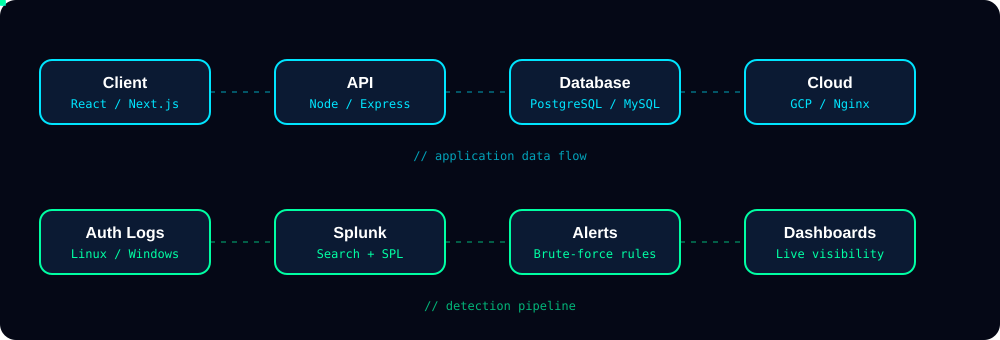

<div align="center">


<br/>

[](https://git.io/typing-svg)

</div>

---

## 👋 About Me



I'm a **software engineer** who sits between **full-stack development** and **IT / security operations**. I build performant web products, and I also like understanding how the systems underneath them are secured, monitored, and managed. I'm also getting into cybersecurity and learning new concepts along the way to further my skill set.

```yaml
hobbies:
  sports: "["Man U. fan", "Volley", "Basketball"]"
  music: "["Jazz", "Techno", "Post Rock"]"
  podcasts: "["Darknet Diaries", "The Best In Jest"]"
fuel: "["Literally water..."]"
```

<br clear="right"/>

---

## How I Think About The Flow

- These are examples of how the data flows from end to end for 2 seperate projects.



---

## Tech Stack

<div>

**Frontend**


**Backend & Data**


**Cloud, Infra & Security**


</div>

---

<div align="center">

</div>
